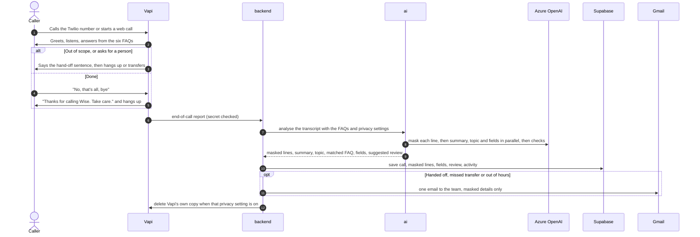

# Money Support Agent

A voice agent that answers Wise customers' "Where is my money?" questions over the phone or in the browser, and hands every other question to a person. A dashboard shows each call with personal data masked, and emails the team when a caller needs a human.

Live dashboard: [money-support-frontend.vercel.app](https://money-support-frontend.vercel.app)

## Problem statement

Build a simple voice agent that can handle incoming calls, using any open-source tool or provider.

1. The agent is a customer support representative that answers questions from the **"Where is my money?"** section of Wise's [Sending money help topic](https://wise.com/help/topics/5bVKT0uQdBrDp6T62keyfz/sending-money).
2. When a caller asks anything else, the agent deflects to a human agent. For this exercise it may say so and end the call.

## Solution

**Vapi runs the live call.** Speech to text (Deepgram), the model (gpt-4o) and the voice all run inside Vapi, so none of our services sit between the caller and the agent. A slow or failed service of ours can never stall a caller.

**Our code works around the call:**

- **ai** builds the agent from the FAQs and settings and pushes it to Vapi. That covers the prompt, the hand-off rule, tools, speaking and noise settings, and guardrails. After each call it runs a **LangGraph** graph on **Azure OpenAI**, which masks personal data and writes the summary, topic, matched FAQ, fields and checks. It also masks the test call's live transcript.
- **backend** receives Vapi's call events, saves the masked call, decides whether a person must review it, and emails the team after a hand-off. It also serves the dashboard.
- **frontend** is the dashboard: overview, calls, review queue with call backs, FAQ editor, test call and settings.

The agent answers six topics, the "Where is my money?" section:

1. How do I check my transfer's status?
2. When will my money arrive?
3. Why does it say my transfer's complete when the money hasn't arrived yet?
4. Why is my transfer taking longer than the estimate?
5. What is a proof of payment?
6. What's a banking partner reference number?

Anything else gets the hand-off sentence, *"Please contact the Wise support team through the Help section of the Wise app or website."* Saying it ends the call. In transfer mode the call goes to the team's number instead.

## Architecture

**One call**

1. The caller rings the Twilio number, or starts a test call in the browser.
2. Vapi hears, thinks and speaks. It answers from the six FAQs, or says the hand-off sentence and hangs up.
3. When the call ends, Vapi sends the end-of-call report to the backend.
4. The backend asks ai to analyse the call.
5. ai masks each line and writes the summary, topic and fields on Azure OpenAI.
6. The backend saves the masked call and opens a review if a person is needed.
7. After a hand-off, a missed transfer or an out-of-hours call, the backend emails the team through Gmail.
8. The team opens the call on the Review page and calls the customer back.

**An admin change**

- **A** An admin edits the FAQs or settings in the dashboard.
- **B** The backend asks ai to rebuild the agent.
- **C** ai updates the Vapi assistant.

**The live transcript**

- **L** During a test call, each caller line goes to the backend and on to ai, which masks it on Azure every 1.5 seconds. Personal data is hidden before the line appears on screen.

### A call, step by step

### The call analysis graph in ai

## Components

| Component | Role |
|---|---|
| **Vapi** | Runs the live call: Deepgram hears, gpt-4o answers, the Vapi voice speaks, and Vapi applies the guardrails. |
| **Twilio** | The phone number callers ring, connected to the Vapi assistant. |
| **ai** | Builds the agent's prompt and settings, analyses each finished call with LangGraph, and masks the live transcript. |
| **Azure OpenAI** | The gpt-4o model ai uses for masking, summaries, topics, fields and checks. |
| **backend** | Receives call reports, saves masked calls, runs the review queue and call backs, and sends hand-off emails. |
| **Supabase** | The database for calls, reviews, FAQs, settings and activity, plus the hourly retention job. |
| **Gmail** | Sends the hand-off emails to the support team. |
| **frontend** | The dashboard where the team reviews calls, calls customers back, edits FAQs and places test calls. |

## Functional requirements

These come straight from the problem statement.

| # | Requirement | How it is met |
|---|---|---|
| F1 | Handle incoming calls | Phone calls through the Twilio number, and web calls from the Test call page, both answered by the Vapi assistant |
| F2 | Act as a Wise customer support representative | A calm, kind, professional agent. It acknowledges problems, checks what it misheard, asks one question at a time, and says it is an automated assistant if asked. |
| F3 | Answer questions from the "Where is my money?" section | The six FAQs are the agent's only knowledge. It answers in under 40 words, never invents facts, and never claims to look up an account. |
| F4 | Deflect any other question to a human agent | Out-of-scope questions, requests for a person, scams, abuse after one warning, and other languages all get the hand-off sentence, or a transfer in transfer mode |
| F5 | Say so and end the call | Saying the hand-off sentence ends the call through Vapi's end-call phrase. Goodbyes end it through the endCall tool, which Vapi blocks until the agent has asked "anything else?" or the caller has said goodbye. |

## Non-functional requirements

| Area | Requirement and how it is met |
|---|---|
| **Latency** | Nothing of ours is called during a turn. A real phone call measured about 3.7 s per turn: 1.7 s waiting for the caller to finish, 1.0 s model, 0.7 s voice, 0.4 s speech to text. Replies stay short so speaking starts sooner. |
| **Prompt caching** | The 2,577-token agent prompt keeps its fixed text first and the live UK time last, and sends a `promptCacheKey` per prompt version. On the last phone call, 48% of prompt tokens were served from OpenAI's cache. The Azure analysis prompts are under Azure's 1,024-token minimum, so Azure doesn't cache them. |
| **Guardrails** | Scope limited to the six FAQs. Vapi's prompt-injection filter. Refuses card numbers, even a few digits. Never repeats personal details. One calm warning for insults. Hand-off sentence spoken word for word. endCall rejection rules. Every agent change is checked by Evals and Simulations. |
| **Data masking** | Every caller line is masked by gpt-4o reading it in context, with no regular expressions. It covers names, card and account numbers (even partial), emails, phone numbers and addresses. The caller's own phone number is kept, and any other phone number is masked. A line that can't be checked is saved as "[waiting for privacy check]", never raw. The test call shows lines masked while the caller is still speaking. |
| **Privacy** | Recording is off. Raw transcripts are never stored. Vapi's copy is deleted after analysis. Caller numbers show as the last digits in lists and emails. The full number is kept for call backs until retention removes it. Retention deletes old data every hour. Emails carry masked details only. |
| **Reliability** | Calls keep working if our services are down. If ai is down, lines are saved as waiting. A failed email never stops a call being saved, and is retried and logged. Repeated Vapi reports never save or email twice. |
| **Security** | Vapi webhooks, internal routes and the retention job each check their own secret. API keys stay on the server. Inputs are validated with Zod and Pydantic. Database connections verify Supabase's certificate. |
| **Observability** | Health checks for the database, ai and call backs. An activity log of calls, hand-offs, emails, reviews and edits. Prompt versions saved with a hash. |

## Tech stack

| Part | Technology |
|---|---|
| Voice | Vapi, gpt-4o, Deepgram nova-3, Vapi voice, LiveKit smart endpointing, Krisp denoising |
| Telephony | Twilio |
| Call analysis | Python 3.12, FastAPI, LangGraph, LangChain, Azure OpenAI gpt-4o, Pydantic, Jinja2 |
| Agent tests | Vapi Evals and Simulations, DeepEval, pytest |
| backend | NestJS 11, TypeScript, Prisma 7, Zod 4, Nest mailer with nodemailer and Gmail SMTP, Jest |
| frontend | Next.js 16, React 19, TypeScript, Tailwind CSS 4, TanStack Table, Recharts, Vapi web SDK, lucide-react |
| Database | Supabase Postgres, Vault, Cron |
| Hosting | Vercel: three projects from this repository, deployed from `main` |

## License

[MIT](LICENSE)
