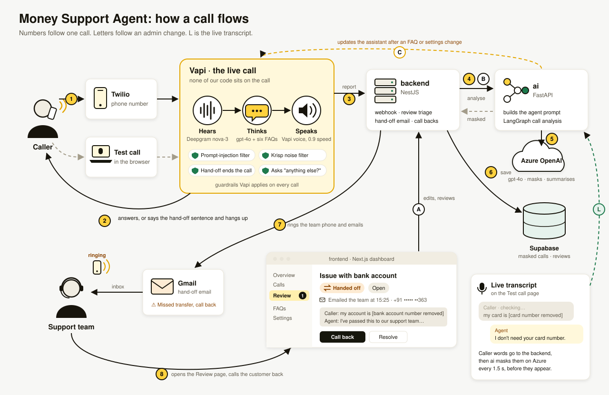
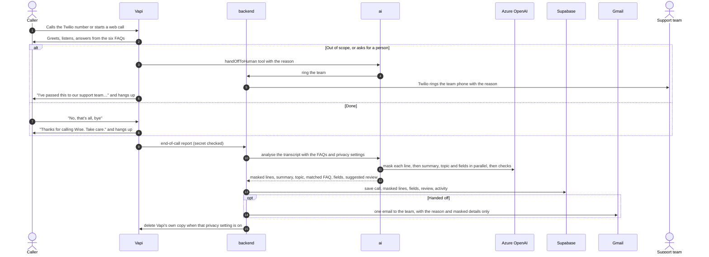
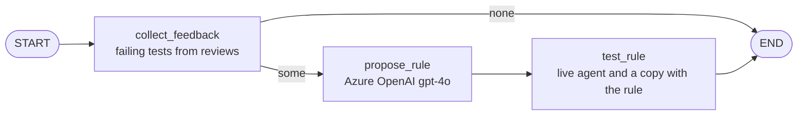
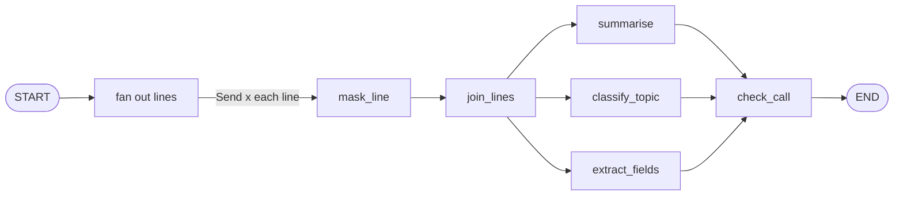

# Money Support Agent

A voice agent that answers Wise customers' "Where is my money?" questions over the phone or in the browser, and hands every other question to a person. A dashboard shows each call with personal data masked, and emails the team when a caller needs a human.

Live dashboard: [money-support-frontend.vercel.app](https://money-support-frontend.vercel.app)

## Problem statement

Build a simple voice agent that can handle incoming calls, using any open-source tool or provider.

1. The agent is a customer support representative that answers questions from the **"Where is my money?"** section of Wise's [Sending money help topic](https://wise.com/help/topics/5bVKT0uQdBrDp6T62keyfz/sending-money).
2. When a caller asks anything else, the agent deflects to a human agent. For this exercise it may say so and end the call.

## Solution

**Vapi runs the live call.** Speech to text (Deepgram), the model (gpt-4o) and the voice all run inside Vapi, so none of our services sit between the caller and the agent. A slow or failed service of ours can never stall a caller.

**Our code works around the call:**

- **ai** builds the agent from the FAQs and settings and pushes it to Vapi. During a call it runs the **hand-off tool**: when the agent decides a caller needs a person, a small LangGraph graph rings the support team straight away. That covers the prompt, the hand-off rule, tools, speaking and noise settings, and guardrails. After each call it runs a **LangGraph** graph on **Azure OpenAI**, which masks personal data and writes the summary, topic, matched FAQ, fields and checks. It also masks the test call's live transcript.
- **backend** receives Vapi's call events, saves the masked call, decides whether a person must review it, rings the team's phone and emails the team after a hand-off. It also serves the dashboard.
- **frontend** is the dashboard: overview, calls, review queue with call backs, FAQ editor, test call, agent quality and settings.

**The agent learns from reviews.** A reviewer can report personal data that masking missed, and mark any reply wrong. Each wrong reply becomes a test, and a LangGraph graph suggests a new rule for the agent, tests it on a copy of the agent, and waits for a person to approve it.

The agent answers six topics, the "Where is my money?" section:

1. How do I check my transfer's status?
2. When will my money arrive?
3. Why does it say my transfer's complete when the money hasn't arrived yet?
4. Why is my transfer taking longer than the estimate?
5. What is a proof of payment?
6. What's a banking partner reference number?

Anything else is handed to a person. The agent calls the `handOffToHuman` tool with the reason, the team's phone rings during the call, the caller hears *"I've passed this to our support team, and someone will be in touch with you shortly."*, and the call ends. In transfer mode the call goes to the team's number instead, and the person who answers is briefed first.

## Architecture

**One call**

1. The caller rings the Twilio number, or starts a test call in the browser.
2. Vapi hears, thinks and speaks, and answers from the six FAQs.
3. If the caller needs a person, Vapi calls the `handOffToHuman` tool on ai, with the reason.
4. ai's LangGraph hand-off graph turns the reason into plain words and asks the backend to ring the team.
5. Twilio rings the support team's phone while the call is still going. Vapi tells the caller "I've passed this to our support team, and someone will be in touch with you shortly." and hangs up.
6. When the call ends, Vapi sends the end-of-call report to the backend.
7. The backend asks ai to analyse the call. ai masks each line and writes the summary, topic and fields on Azure OpenAI.
8. The backend saves the masked call and opens a review.
9. The backend emails the team, including why the caller needed a person.
10. The team opens the call on the Review page and calls the customer back.

**An admin change**

- **A** An admin edits the FAQs or settings in the dashboard.
- **B** The backend asks ai to rebuild the agent.
- **C** ai updates the Vapi assistant.

**Learning from reviews**

- **R** A reviewer reports personal data in a line. ai checks the line again and masks only the leaked words, then the call's summary and fields are re-analysed. The rest of the transcript stays as it was.
- **T** A reviewer marks a reply wrong. The caller's line before it becomes a test, run with the 25 built-in tests before every agent change.
- **S** On the Agent quality page, "Suggest an improvement" runs the improvement graph: it reads the failing tests from reviews, writes one rule on Azure OpenAI, and tests it on a temporary copy of the agent.
- **P** A person approves the rule. It is added to the end of the agent's prompt, the agent is updated, and a new prompt version is saved. The Overview shows whether the new version makes fewer mistakes.

**The live transcript**

- **L** During a test call, each caller line goes to the backend and on to ai, which masks it on Azure every 1.5 seconds. Personal data is hidden before the line appears on screen.

### A call, step by step

### The improvement graph in ai

The graph never changes the live agent. It returns the rule and the test results, and the backend saves it as a suggestion that waits for a person.

### The call analysis graph in ai

## Components

| Component | Role |
|---|---|
| **Vapi** | Runs the live call: Deepgram hears, gpt-4o answers, the Vapi voice speaks, and Vapi applies the guardrails. |
| **Twilio** | The phone number callers ring, the ring to the team's phone after a hand-off, and call backs. |
| **ai** | Builds the agent's prompt and settings, runs the hand-off tool during calls, analyses each finished call with LangGraph, masks the live transcript, re-checks reported lines, and runs the improvement graph. |
| **Azure OpenAI** | The gpt-4o model ai uses for masking, summaries, topics, fields and checks. |
| **backend** | Receives call reports, saves masked calls, runs the review queue and call backs, rings the team phone, sends hand-off emails, turns wrong verdicts into tests, and keeps suggestions and learned rules. |
| **Supabase** | The database for calls, reviews, FAQs, settings and activity, plus the hourly retention job. |
| **Gmail** | Sends the hand-off emails to the support team. |
| **frontend** | The dashboard where the team reviews calls, calls customers back, edits FAQs, places test calls, and runs tests and approves improvements on the Agent quality page. |

## Functional requirements

These come straight from the problem statement.

| # | Requirement | How it is met |
|---|---|---|
| F1 | Handle incoming calls | Phone calls through the Twilio number, and web calls from the Test call page, both answered by the Vapi assistant |
| F2 | Act as a Wise customer support representative | A calm, kind, professional agent. It acknowledges problems, checks what it misheard, asks one question at a time, and says it is an automated assistant if asked. |
| F3 | Answer questions from the "Where is my money?" section | The six FAQs are the agent's only knowledge. It answers in under 40 words, never invents facts, and never claims to look up an account. |
| F4 | Deflect any other question to a human agent | Out-of-scope questions, requests for a person, scams, abuse after one warning, and other languages all make the agent call the `handOffToHuman` tool. The team's phone rings during the call and the team is emailed. In transfer mode the caller is connected to the team instead. |
| F5 | Say so and end the call | After the hand-off tool runs, Vapi speaks the hand-off sentence and ends the call, even if ringing the team failed. Goodbyes end it through the endCall tool, which Vapi blocks until the agent has asked "anything else?" or the caller has said goodbye. |

## Non-functional requirements

| Area | Requirement and how it is met |
|---|---|
| **Latency** | Nothing of ours is called during a turn. A real phone call measured about 3.7 s per turn: 1.7 s waiting for the caller to finish, 1.0 s model, 0.7 s voice, 0.4 s speech to text. Replies stay short so speaking starts sooner. |
| **Prompt caching** | The 2,577-token agent prompt keeps its fixed text first and the live UK time last, and sends one stable `promptCacheKey`. Learned rules are added at the end, so after a rule is approved the first ~2,500 tokens are still served from cache. On the last phone call, 48% of prompt tokens were served from OpenAI's cache. The Azure analysis prompts are under Azure's 1,024-token minimum, so Azure doesn't cache them. |
| **Guardrails** | Scope limited to the six FAQs. Vapi's prompt-injection filter. Refuses card numbers, even a few digits. Never repeats personal details. One calm warning for insults. Hand-off sentence spoken word for word. endCall rejection rules. Every agent change is checked by Evals and Simulations. |
| **Data masking** | Every caller line is masked by gpt-4o reading it in context, with no regular expressions. It covers names, card and account numbers (even partial), emails, phone numbers and addresses. The caller's own phone number is kept, and any other phone number is masked. A line that can't be checked is saved as "[waiting for privacy check]", never raw. The test call shows lines masked while the caller is still speaking. A line a reviewer reports is checked again more strictly and only the leaked words are masked; each miss is saved as a pattern, never the real value. |
| **Privacy** | Recording is off. Raw transcripts are never stored. Vapi's copy is deleted after analysis. Caller numbers show as the last digits in lists and emails. The full number is kept for call backs until retention removes it. Retention deletes old data every hour. Emails carry masked details only. |
| **Reliability** | Calls keep working if our services are down. If ai is down, lines are saved as waiting. A failed ring or email never stops a call being saved or the caller being told. Failures are logged. Repeated Vapi reports never save or email twice. |
| **Security** | Vapi webhooks, internal routes and the retention job each check their own secret. API keys stay on the server. Inputs are validated with Zod and Pydantic. Database connections verify Supabase's certificate. |
| **Observability** | Health checks for the database, ai and call backs. An activity log of calls, hand-offs, emails, reviews and edits. Prompt versions saved with a hash. |
| **Learning from reviews** | Every wrong verdict becomes a test that runs before each agent change, so a fixed mistake can't come back. Suggested rules are tested on a copy of the agent and only go live after a person approves them; a rule can be switched off in one click. Overview compares mistakes by prompt version. |

## Tech stack

| Part | Technology |
|---|---|
| Voice | Vapi, gpt-4o, Deepgram nova-3, Vapi voice, LiveKit smart endpointing, Krisp denoising |
| Telephony | Twilio: phone number, team alerts and call backs |
| Call analysis | Python 3.12, FastAPI, LangGraph, LangChain, Azure OpenAI gpt-4o, Pydantic, Jinja2 |
| Agent tests | Vapi Evals and Simulations, DeepEval, pytest |
| backend | NestJS 11, TypeScript, Prisma 7, Zod 4, Nest mailer with nodemailer and Gmail SMTP, Jest |
| frontend | Next.js 16, React 19, TypeScript, Tailwind CSS 4, TanStack Table, Recharts, Vapi web SDK, lucide-react |
| Database | Supabase Postgres, Vault, Cron |
| Hosting | Vercel: three projects from this repository, deployed from `main` |

## License

[MIT](LICENSE)
